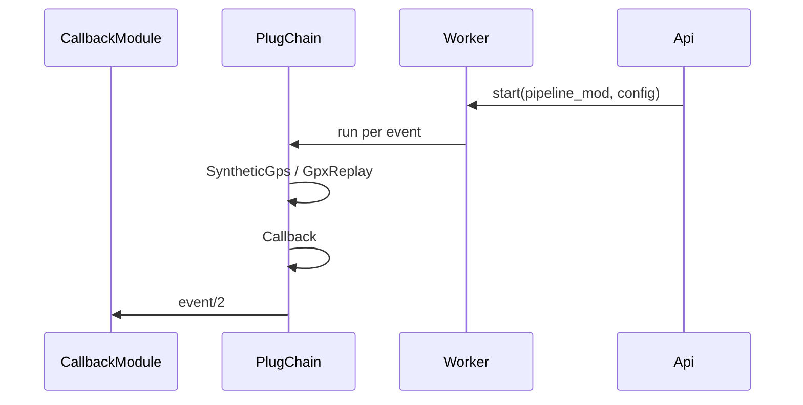

[](https://hexdocs.pm/location_simulator)
[](https://hex.pm/packages/location_simulator)

# LocationSimulator

Simulate GPS location data for development and testing. Supports synthetic GPS generation and GPX track replay, built on a pluggable pipeline architecture inspired by Phoenix.

## Installation

```elixir
def deps do
  [
    {:location_simulator, "~> 1.0"}
  ]
end
```

## Architecture

The library is built around three composable layers:

### 1. Pipeline DSL (Spark)

Declare your simulation pipeline at compile time using `LocationSimulator.Pipeline`:

```elixir
defmodule MyApp.Simulation do
  use LocationSimulator.Pipeline

  source :synthetic, direction: :north, elevation: 50

  plug LocationSimulator.Plug.Callback, callback: MyApp.GpsHandler
end
```

### 2. Plugs (`LocationSimulator.Plug` behaviour)

Each plug transforms a pipeline map (`config`, `state`, `gps`, `halted`, `assigns`).

Built-in plugs:

| Plug | Purpose |
|---|---|
| `LocationSimulator.Plug.SyntheticGps` | Generates next synthetic GPS point (handles direction & elevation) |
| `LocationSimulator.Plug.GpxReplay` | Replays the next GPX track point |
| `LocationSimulator.Plug.Callback` | Dispatches events to your `LocationSimulator.Event` callback |
| `LocationSimulator.Plug.Sleep` | Rate-limits between events |

### 3. Callback (`LocationSimulator.Event` behaviour)

Your application code receives GPS events via a callback module implementing `start/2`, `event/2`, `stop/2`.

### API call flow



## Usage

### Quick start (legacy API)

```elixir
LocationSimulator.start()
```

### With a pipeline module (recommended)

```elixir
defmodule MyApp.Tracker do
  use LocationSimulator.Pipeline

  source :synthetic, direction: :north, elevation: 100, elevation_way: :up

  plug LocationSimulator.Plug.Callback, callback: MyApp.GpsHandler
end

LocationSimulator.start(MyApp.Tracker, %{worker: 3, event: 100, interval: 1_000})
```

### With a plain config map (legacy API)

```elixir
LocationSimulator.start(%{
  worker: 3,
  event: 100,
  interval: 1000,
  random_range: 0,
  direction: :north,
  elevation: 100,
  callback: MyApp.GpsHandler
})
```

## Source types

### `:synthetic`

Generates fake GPS coordinates that travel in a given direction.

```elixir
defmodule MyApp.Synthetic do
  use LocationSimulator.Pipeline

  source :synthetic, direction: :north_east, elevation: 50, elevation_way: :up

  plug LocationSimulator.Plug.Callback, callback: MyApp.Handler
end
```

Supported directions: `:north`, `:south`, `:east`, `:west`, `:north_east`, `:north_west`, `:south_east`, `:south_west`, `:random`.

Elevation options: `elevation_way: :up | :down | :no_up_down`.

### `:gpx`

Replays a GPX track file. Uses `:gpx_time` or a fixed interval between points.

```elixir
defmodule MyApp.GpxReplay do
  use LocationSimulator.Pipeline

  source :gpx, gpx_file: "data/*.gpx"

  plug LocationSimulator.Plug.Callback, callback: MyApp.Handler
end

LocationSimulator.start(MyApp.GpxReplay, %{worker: 3, interval: :gpx_time})
```

## Writing a callback module

Implement `LocationSimulator.Event`:

```elixir
defmodule MyApp.GpsHandler do
  @behaviour LocationSimulator.Event

  @impl true
  def start(config, _state), do: {:ok, config}

  @impl true
  def event(config, %{gps: gps}) do
    IO.inspect(gps, label: "GPS")
    {:ok, config}
  end

  @impl true
  def stop(config, state) do
    IO.puts("Done: #{state.success} ok, #{state.failed} failed")
    {:ok, config}
  end
end
```

## Writing a custom plug

Implement `LocationSimulator.Plug`:

```elixir
defmodule MyApp.LoggingPlug do
  @behaviour LocationSimulator.Plug

  @impl true
  def init(opts), do: opts

  @impl true
  def call(pipeline, _opts) do
    IO.puts("GPS event: #{inspect(pipeline.gps)}")
    pipeline
  end
end

defmodule MyApp.Pipeline do
  use LocationSimulator.Pipeline

  source :synthetic, direction: :north

  plug MyApp.LoggingPlug
  plug LocationSimulator.Plug.Callback, callback: MyApp.Handler
end
```

## Starting at a fixed position

```elixir
source :synthetic, started_gps: {20.9599, 107.0666, 0}
```

## Group stop

Workers can be grouped and stopped together:

```elixir
LocationSimulator.start(MyApp.Pipeline, %{worker: 4, group_id: :my_group})
# later:
LocationSimulator.stop(:my_group)
```

## Runtime config reference

| Key | Type / Values | Default |
|---|---|---|
| `worker` | `pos_integer()` | `1` |
| `event` | `pos_integer() \| :infinity` | `1` |
| `interval` | `pos_integer() \| :gpx_time` | `100` ms |
| `random_range` | `non_neg_integer()` | `10` ms jitter |
| `direction` | see source DSL | `:random` |
| `elevation` | `integer()` | `0` |
| `elevation_way` | `:up \| :down \| :no_up_down` | `:no_up_down` |
| `callback` | module implementing `Event` | `LocationSimulator.LoggerEvent` |
| `group_id` | `any()` | `nil` |
| `gpx_file` | glob string | `nil` |
| `started_gps` | `{lat, lon, ele}` | `nil` |

## Example

```bash
mix deps.get
iex -S mix

iex(1)> LocationSimulator.start()
```
