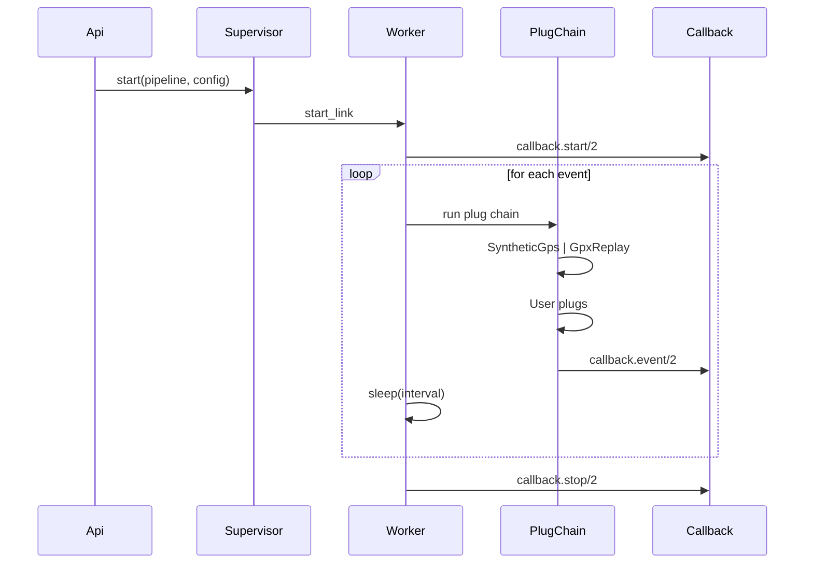

[comment]: # (guides/architecture.md)

# Architecture

LocationSimulator is built on a **pluggable pipeline architecture** inspired by Phoenix's `Plug` and uses **Spark DSL** for compile-time pipeline declarations.

## Layers

```
┌─────────────────────────────────────────────┐
│                DSL Layer                     │
│  (Spark.Dsl.Extension)                      │
│  LocationSimulator.Dsl                      │
│  LocationSimulator.Pipeline                 │
├─────────────────────────────────────────────┤
│             Application Layer               │
│  LocationSimulator.Plug   (behaviour)       │
│  LocationSimulator.Event  (behaviour)       │
│  LocationSimulator        (entry point)     │
├─────────────────────────────────────────────┤
│           Infrastructure Layer              │
│  LocationSimulator.Plug.*  (built-in plugs) │
│  LocationSimulator.Worker  (loop runner)    │
│  LocationSimulator.Gpx     (GPX parser)     │
│  LocationSimulator.Gps     (GPS math)       │
│  DynamicSupervisor / Registry               │
└─────────────────────────────────────────────┘
```

## Pipeline DSL (compile time)

Users declare their simulation flow using `use LocationSimulator.Pipeline`, which registers a Spark DSL extension. The `source` and `plug` entities are validated at compile time.

```elixir
defmodule MyApp.Sim do
  use LocationSimulator.Pipeline

  source :synthetic, direction: :north
  plug LocationSimulator.Plug.Callback, callback: MyApp.Handler
end
```

## Plugs (runtime)

Each event goes through a chain of plugs. A plug implements the `LocationSimulator.Plug` behaviour:

```
call(pipeline, opts) :: pipeline
```

The pipeline is a map with keys:

| Key | Type | Description |
|---|---|---|
| `config` | `map()` | Worker config (shared, mutable) |
| `state` | `map()` | Worker state (`start_time`, `success`, `failed`, `gps`; plus `gpx_data` for GPX workers) |
| `gps` | `map()` | Current GPS point `%{lat, lon, ele, timestamp}` |
| `halted` | `boolean()` | When `true`, stops processing |
| `assigns` | `map()` | Arbitrary data for plug-to-plug communication |

## Event flow



## Key design decisions

- **Composability** — Plugs can be added, removed, or reordered. Users write custom plugs for custom behaviour.
- **Separation of concerns** — Source type (synthetic vs GPX) is handled by the source plug. Callbacks are handled by the Callback plug. Timing is handled by the worker loop.
- **Backward compatibility** — The `LocationSimulator.start/1` with a plain config map still works, creating a default pipeline under the hood.
- **DSL at compile time, plugs at runtime** — The Spark DSL validates pipeline structure at compile time, while plugs run per event with no overhead.
